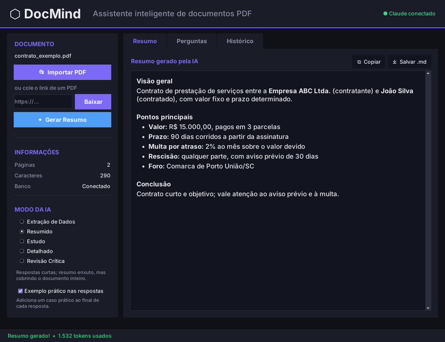
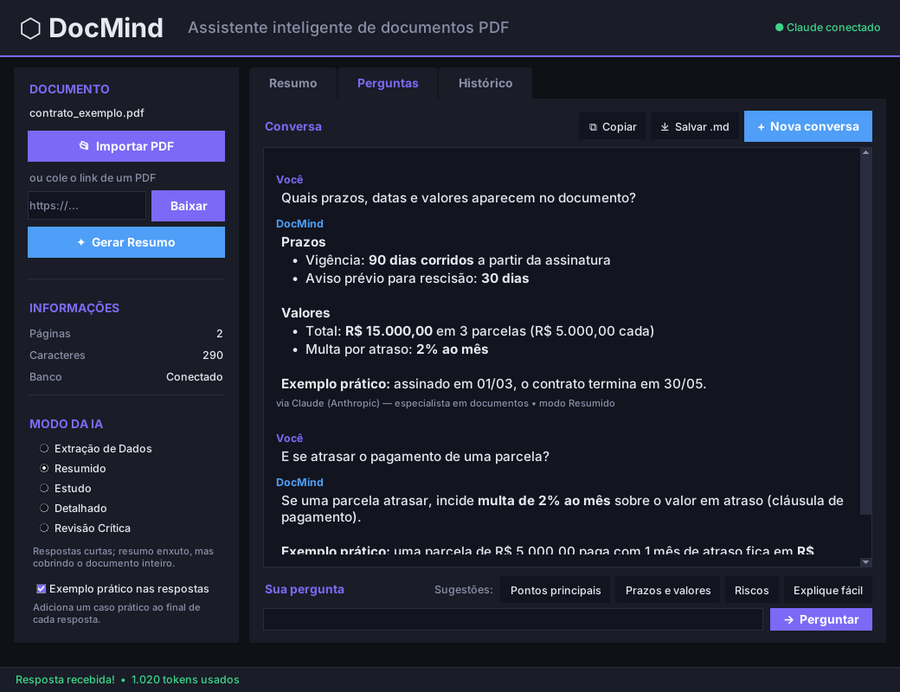
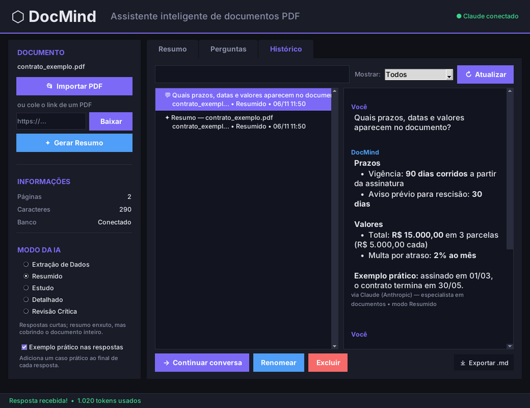

# DocMind

[](https://github.com/AlessandroLuizLima/docmind/actions/workflows/testes.yml)


**Entenda qualquer PDF em minutos.** O DocMind é um assistente desktop que lê um documento PDF e, com Inteligência Artificial, gera resumos, responde perguntas sobre o conteúdo e transforma o texto em material de estudo.



## Para que serve

Ler um contrato de 40 páginas, um edital ou um artigo científico inteiro leva tempo. O DocMind faz a primeira leitura por você:

| Situação | Como o DocMind ajuda |
|---|---|
| Vou assinar um contrato | Modo **Revisão Crítica** aponta lacunas, ambiguidades e riscos |
| Tenho prova amanhã | Modo **Estudo** gera resumo por tópicos, flashcards e questões com gabarito |
| Preciso dos números de um relatório | Modo **Extração de Dados** lista datas, valores, nomes e prazos |
| Só quero saber do que se trata | Modo **Resumido** dá uma visão geral do documento inteiro |
| Tenho uma dúvida específica | Aba **Perguntas**: converse com o documento, com contexto das mensagens anteriores |

## Integrantes do Grupo

- Alessandro Luiz de Lima
- Douglas de Jesus
- Arthur Henrique Svidzinski
- Breno Suski

## Funcionalidades

**Entrada do documento**
- Importa PDF do computador ou baixa direto de um link (até 40 MB, com validação do arquivo)
- Avisa quando o PDF é escaneado (só imagem) e não tem texto para ler

**Cinco modos da IA**: cada modo muda o *tipo* de saída, tanto no resumo quanto nas perguntas

| Modo | Resumo | Perguntas |
|---|---|---|
| Extração de Dados | Pessoas, datas, valores, termos, obrigações e referências em listas | Só os dados objetivos, indicando de onde vieram |
| Resumido | Visão geral + 6 a 10 tópicos + conclusão | Resposta em até 3 linhas |
| Estudo | Tópicos, conceitos-chave, 5 flashcards e 3 questões com gabarito | Explica como um professor e faz uma pergunta de fixação |
| Detalhado | Seção por seção, mantendo números e nomes | Resposta aprofundada com contexto |
| Revisão Crítica | Pontos fortes, lacunas, contradições e riscos | Separa o que está no texto do que é inferência |

**Resumos completos de documentos longos**: o texto é dividido em partes, cada parte é resumida e os resumos são unificados no final, para que o fim do documento não seja ignorado.

**Perguntas**
- Sugestões prontas (Pontos principais, Prazos e valores, Riscos, Explique fácil): um clique envia
- A IA considera as mensagens anteriores da conversa ("e o prazo?", "explique o item 2")
- Toda resposta termina com um **Exemplo prático** (pode ser desligado na barra lateral)
- Roteamento entre duas IAs: perguntas sobre o documento vão para o **Claude**; perguntas gerais vão para o **Gemini** (se a chave do Google estiver configurada)

**Exportação**: resumos e conversas podem ser copiados ou salvos em Markdown (`.md`), prontos para colar num relatório, no Notion ou no GitHub.

**Histórico**: tudo fica salvo no PostgreSQL. Na aba Histórico dá para buscar (no título, no nome do arquivo e no conteúdo), filtrar, continuar uma conversa, renomear, exportar e excluir. Sem banco de dados o app funciona normalmente, só não guarda o histórico.

**Segurança**: as perguntas passam por um filtro contra prompt injection, comandos maliciosos e tentativas de mudar a identidade da IA. O texto do PDF é tratado como conteúdo, nunca como instrução.

<p align="center">
  
  
</p>

### Atalhos de teclado

| Atalho | Ação |
|---|---|
| `Ctrl+O` | Abrir PDF do computador |
| `Ctrl+L` | Ir para o campo de link (para colar a URL de um PDF) |
| `Ctrl+R` | Gerar resumo |
| `Ctrl+N` | Nova conversa |
| `Ctrl+S` | Salvar a aba atual como Markdown |
| `Ctrl+1` / `2` / `3` | Ir para Resumo / Perguntas / Histórico |

No macOS, use `Cmd` no lugar de `Ctrl`.

## Tecnologias

| Área | Ferramentas |
|---|---|
| Linguagem e interface | Python 3.10+, Tkinter (tema escuro) |
| Inteligência Artificial | Claude (Anthropic) e Gemini (Google), orquestrados com LangChain |
| Documentos | pypdf (extração de texto), requests (download por link) |
| Persistência | PostgreSQL + psycopg2 |
| Qualidade | Pytest (testes sem internet e sem chave de API), GitHub Actions |

## Estrutura do projeto

```
docmind/
├── main.py                 # ponto de entrada: python main.py
├── app.py                  # interface gráfica (Tkinter)
├── DocMindAPI.py           # IA: modos, prompts, resumo por partes, roteador Claude/Gemini
├── docmind/                # lógica reutilizável, independente da interface
│   ├── pdf.py              #   leitura de PDF e download por link
│   ├── seguranca.py        #   filtro de prompt injection e pedidos indevidos
│   └── exportar.py         #   exportação de resumos e conversas em Markdown
├── database/
│   ├── database.py         # funções de acesso ao PostgreSQL
│   └── schema.sql          # tabelas (criadas automaticamente na 1ª execução)
├── tests/                  # suíte Pytest
├── docs/img/               # capturas de tela do README
├── .env.example            # modelo das variáveis de ambiente
└── .github/workflows/      # CI: roda os testes a cada push
```

## Como funciona

```
 PDF (arquivo ou link)
        │
        ▼
 docmind/pdf.py ── extrai o texto ──► PostgreSQL (documento)
        │
        ├──► Resumo ── texto dividido em partes ──► Claude resume cada parte
        │                                           └─► Claude unifica no modo escolhido
        │
        └──► Pergunta ── docmind/seguranca.py (filtro)
                         └─► roteador: documento → Claude │ geral → Gemini
                             (com os trechos mais relevantes do PDF e as últimas mensagens)
                                        │
                                        ▼
                         resposta na tela + histórico no PostgreSQL + exportação .md
```

## Instalação e execução

### Pré-requisitos

- Python 3.10 ou superior
- Uma chave da API da Anthropic (Claude): crie em [console.anthropic.com](https://console.anthropic.com)
- Opcional: chave do Google (Gemini) e PostgreSQL para o histórico

### 1. Clonar o repositório

```bash
git clone https://github.com/AlessandroLuizLima/docmind.git
cd docmind
```

### 2. Criar e ativar um ambiente virtual

```bash
python -m venv venv

# Windows
venv\Scripts\activate

# Linux/Mac
source venv/bin/activate
```

### 3. Instalar as dependências

```bash
pip install -r requirements.txt
```

No Linux, o Tkinter pode precisar ser instalado à parte: `sudo apt install python3-tk`.

### 4. Configurar as variáveis de ambiente

Copie o modelo e preencha com as suas chaves:

```bash
# Windows
copy .env.example .env

# Linux/Mac
cp .env.example .env
```

| Variável | Obrigatória | Para quê |
|---|---|---|
| `ANTHROPIC_API_KEY` | Sim | Resumos e perguntas (Claude). Também aceita `CLAUDE_API_KEY` |
| `GOOGLE_API_KEY` | Não | Perguntas gerais (Gemini). Também aceita `GEMINI_API_KEY`. Sem ela, tudo usa o Claude |
| `DB_HOST`, `DB_PORT`, `DB_NAME`, `DB_USER`, `DB_PASSWORD` | Não | Histórico no PostgreSQL |

### 5. Banco de dados (opcional)

Crie o banco indicado em `DB_NAME` (por exemplo, `createdb docmind`). As tabelas são criadas automaticamente na primeira execução. Sem PostgreSQL, a barra lateral mostra "Banco: Desconectado" e o resto funciona normalmente.

### 6. Executar

```bash
python main.py
```

### 7. Rodar os testes

```bash
pytest
```

Os testes de IA usam um modelo falso, então não gastam créditos nem precisam de internet. Os testes de banco rodam quando há um PostgreSQL configurado no `.env` e são pulados caso contrário.

## Status do projeto

- [x] Interface gráfica com tema escuro, tela de boas-vindas, sugestões e atalhos
- [x] Cinco modos de IA, com resumo por partes para documentos longos
- [x] Integração com Claude e Gemini via LangChain, com roteamento automático
- [x] Importação por arquivo ou link, com aviso para PDFs escaneados
- [x] Histórico em PostgreSQL com busca, filtros e continuação de conversas
- [x] Exportação de resumos e conversas em Markdown
- [x] Filtro de segurança centralizado no pacote `docmind/`, com testes
- [x] Testes automatizados (Pytest) e CI no GitHub Actions
- [ ] OCR para PDFs escaneados
- [ ] Ouvir o resumo em áudio (texto-para-voz)
- [ ] Executável para distribuição (PyInstaller)
